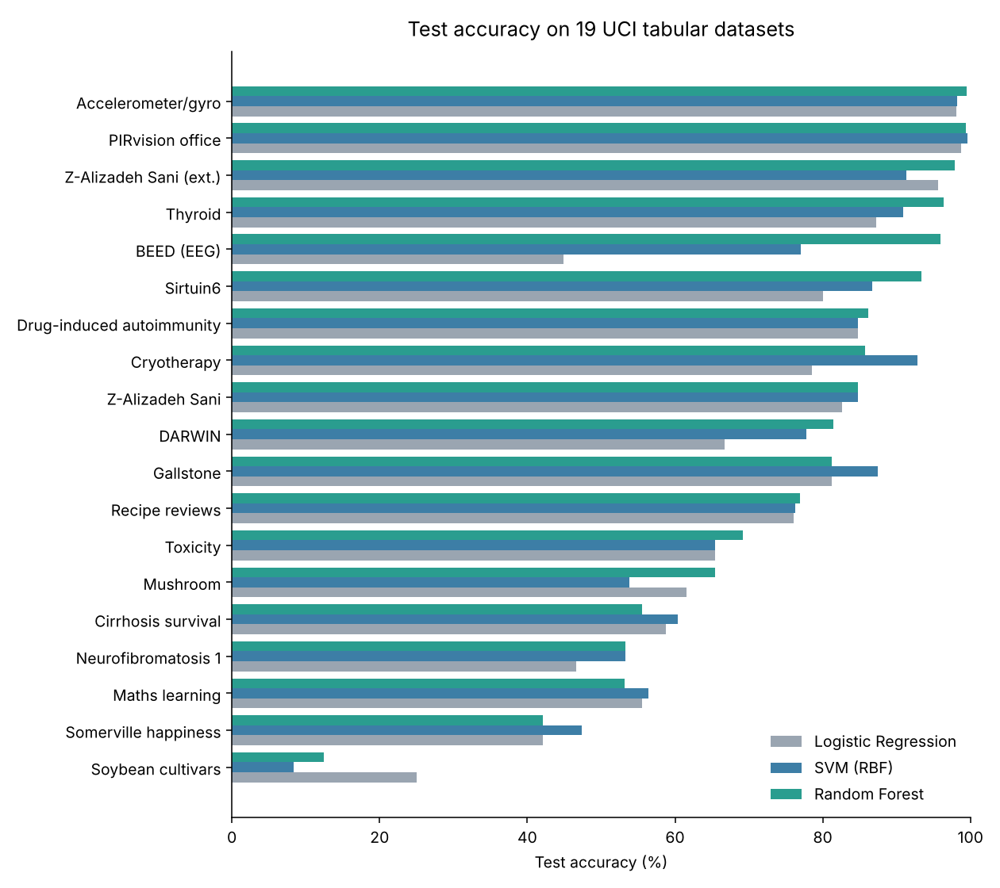

# Benchmarking Classical ML on 23 UCI Datasets

How well do standard machine learning models hold up across many real-world problems? This project runs the same pipeline over **23 datasets** from the UCI Machine Learning Repository (tabular, text and images), comparing supervised classifiers and unsupervised clustering. It is inspired by the paper [*Do we Need Hundreds of Classifiers to Solve Real World Classification Problems?*](https://jmlr.org/papers/v15/delgado14a.html) (Fernández-Delgado et al., JMLR 2014).

> Mini-project for *Applied Artificial Intelligence (D7041E)*, Luleå University of Technology. Group 14, submitted for the highest grade (5).



## Highlights

- **Random Forest came out on top:** best or tied-best on 12 of 19 tabular datasets, with the highest mean test accuracy. This reproduces the paper's headline finding at a smaller scale.
- **One reusable pipeline** cleans, encodes, splits, cross-validates and evaluates any `;`-separated CSV with a `target` column.
- **Beyond tables:** TF-IDF + Naive Bayes for SMS spam, and transfer learning (ResNet50, MobileNetV2) for two image datasets.

## Results

Mean test accuracy over the 19 tabular datasets with a usable target:

| Model | Mean test accuracy | Best or tied-best on |
|---|---|---|
| **Random Forest** | **75.3%** | **12 / 19** |
| SVM (RBF kernel) | 73.3% | 8 / 19 |
| Logistic Regression | 70.0% | 1 / 19 |

Per-dataset numbers are in [`results/test_accuracy_by_dataset.csv`](results/test_accuracy_by_dataset.csv).

**What the results show**
- **Non-linear models win on complex data.** On the BEED dataset, logistic regression scored 45%, SVM 77% and Random Forest 96%.
- **Easy problems are easy for everyone.** Sensor-based datasets (accelerometer, PIRvision) reached 98–100% with all three models.
- **Some datasets are simply hard.** Soybean cultivars (many classes, few samples) and the Somerville happiness survey stayed below 50%, which says more about the signal in the data than about the models.
- **Small test sets are noisy.** Datasets with only 14–50 test samples (Cryotherapy, Sirtuin6) show large gaps between cross-validation and test accuracy, so the cross-validation means are the more reliable comparison.

## Datasets

| Type | Datasets |
|---|---|
| **Tabular (20)** | Student dropout, cirrhosis survival, drug-induced autoimmunity, maths learning, recipe reviews, BEED, PIRvision office, accelerometer/gyroscope, toxicity, soybean cultivars, thyroid, secondary mushroom, DARWIN, Somerville happiness, Z-Alizadeh Sani (and its extension), cryotherapy, Sirtuin6, neurofibromatosis type 1, gallstone |
| **Text (1)** | SMS Spam Collection |
| **Image (2)** | Jute Pest, RealWaste |

All are freely available from the [UCI Machine Learning Repository](https://archive.ics.uci.edu) and are not redistributed here.

## Method

**Preprocessing (every tabular dataset)**
1. Normalise column names; drop columns more than 50% empty.
2. Impute numbers with the median and categories with the mode; remove duplicates.
3. Label-encode the target and categorical features.
4. Stratified split: 70% train, 15% validation, 15% test.
5. Standardise features for the scale-sensitive models (logistic regression, SVM); Random Forest uses raw features.

**Supervised:** Logistic Regression, SVM with an RBF kernel, and Random Forest (200 trees). Each model gets 5-fold stratified cross-validation on the training set, then is refit and scored on validation and test (accuracy, macro F1, confusion matrix).

**Unsupervised:** with the target removed, K-Means, DBSCAN and agglomerative clustering, visualised on the first two principal components.

**Text:** TF-IDF vectorisation (English stop words removed) with Multinomial Naive Bayes.

**Images:** a frozen ImageNet backbone (ResNet50 for Jute Pest, MobileNetV2 for RealWaste) with augmentation (flips, rotation, zoom) and a new classification head trained with Adam.

## Repository structure

```
├── src/
│   ├── tabular_benchmark.py   # preprocessing + supervised and unsupervised benchmark
│   ├── spam_detection.py      # TF-IDF + Naive Bayes on SMS Spam
│   └── image_transfer.py      # transfer learning for image datasets
├── results/                   # per-dataset accuracy table
├── assets/                    # README figures
├── legacy/                    # original Colab export, kept for reference
└── requirements.txt
```

## Running it

```bash
pip install -r requirements.txt

# Put the UCI CSVs (';'-separated, with a 'target' column) in data/tabular/
python src/tabular_benchmark.py --data data/tabular
python src/tabular_benchmark.py --data data/tabular --unsupervised

python src/spam_detection.py --data data/text/SMSSpamCollection
python src/image_transfer.py --data data/images/jute_pest --backbone resnet50
python src/image_transfer.py --data data/images/realwaste --backbone mobilenetv2
```

Results and figures are written to `results/`.

**In VS Code:** create a virtual environment (`python -m venv .venv`, then `pip install -r requirements.txt`), open the folder and select the `.venv` interpreter. The **Run and Debug** panel has a launch configuration for each command above (`.vscode/launch.json`).

The scripts were refactored from the original Colab notebook (kept in [`legacy/`](legacy)), which repeated the same pipeline cell by cell for each dataset. The logic is unchanged apart from two fixes: newer pandas text columns are now encoded correctly, and RealWaste images are resized to the 224 px the model expects.

## Team

**Aamer Barood** (Aamer Ahmed) and Hind Dafallah.
